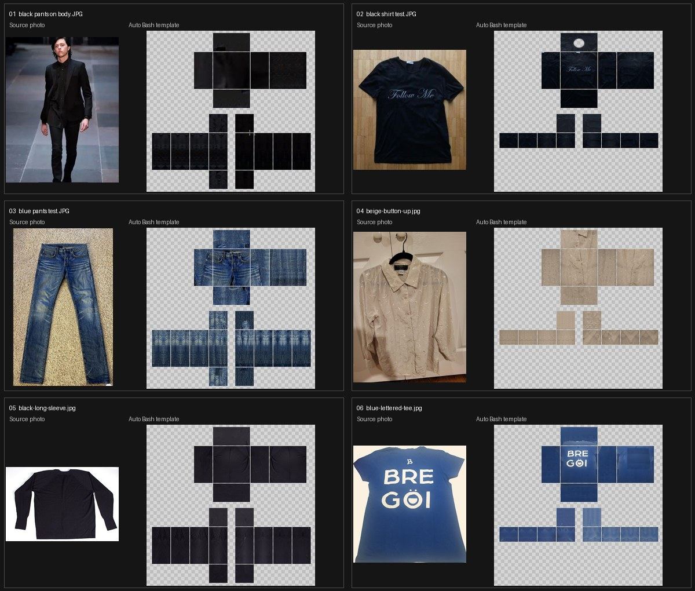
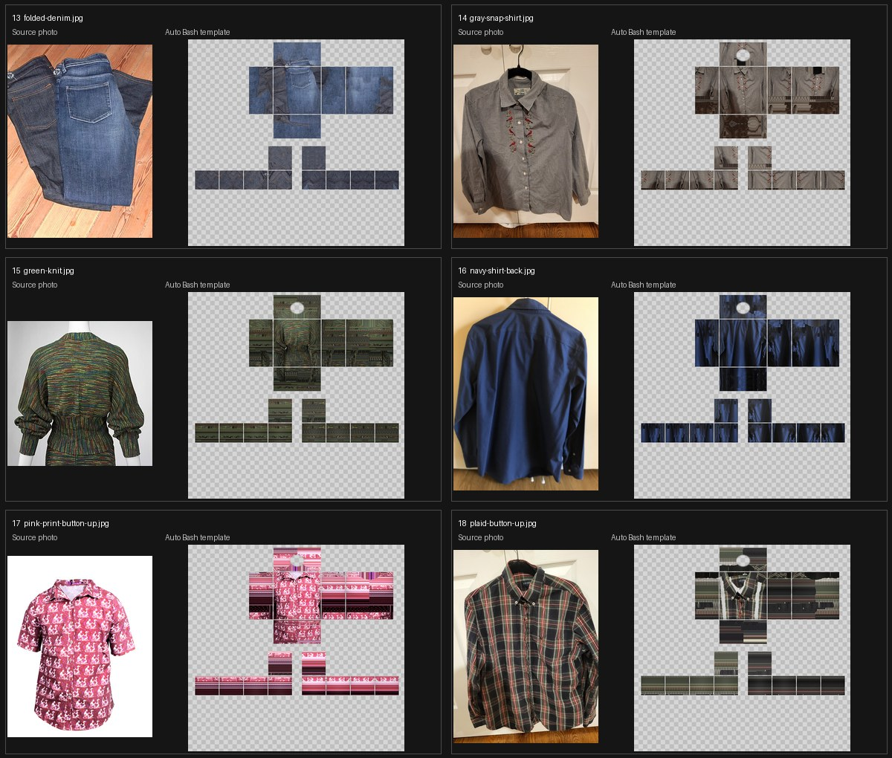

# Stage 8 golden sample review

Auto Bash attempted all 30 photos through the same pipeline as the web app. It returned 29 templates. **3 of 30** reached at least 4/5 on every criterion. **The quality gate remains open.**

The first pass returned 24 templates. The later passes recovered the black long-sleeve top, the red puffer, the dark folded hoodie, and other cutouts that failed the first pass. The revised blue tee retains the pale lettering and blue body. The original worn white top now keeps both patterned sleeves and its full photographed print. The ratings still reflect print placement, sleeve length, or seam issues where they are visible.

The scores below are visual judgments on a 1–5 scale. A dash means there was no template to grade. The in-app estimate is a separate automated confidence score. The review uses the four original inputs and 26 [attributed Wikimedia Commons photos](../golden/SOURCES.md), with single garments prioritized.

## Ratings

| Photo and template | Placement | Proportions | Edges | Seams | Fabric | Shading | Details | Color | Back and sides | Estimate | Notes |
|---|---:|---:|---:|---:|---:|---:|---:|---:|---:|---:|---|
| [black-pants-on-body](../black%20pants%20on%20body.JPG) · [PNG](black-pants-on-body.png) | 3 | 3 | 3 | 3 | 2 | 3 | 2 | 3 | 2 | 63% | The waist and legs are identifiable. Dark folds and copied cloth still hide some seams. |
| [black-shirt-test](../black%20shirt%20test.JPG) · [PNG](black-shirt-test.png) | 4 | 4 | 4 | 4 | 4 | 4 | 4 | 4 | 3 | 84% | The dark fabric, neckline and lettering read clearly. The guessed back repeats folds. |
| [blue-pants-test](../blue%20pants%20test.JPG) · [PNG](blue-pants-test.png) | 4 | 4 | 4 | 3 | 3 | 4 | 4 | 4 | 3 | 77% | The waist and cuffs read correctly. Some knee fades repeat around the wrap. |
| [beige-button-up](../golden/beige-button-up.jpg) · [PNG](beige-button-up.png) | 2 | 2 | 3 | 3 | 3 | 3 | 3 | 4 | 2 | 61% | The collar and buttons are present. The long sleeves are cropped into short arm panels. |
| [black-long-sleeve](../golden/black-long-sleeve.jpg) · [PNG](black-long-sleeve.png) | 4 | 4 | 4 | 4 | 4 | 4 | 4 | 4 | 4 | 85% | Full sleeves and cuffs, clean dark color, and a plausible plain back. |
| [blue-lettered-tee](../golden/blue-lettered-tee.jpg) · [PNG](blue-lettered-tee.png) | 4 | 3 | 4 | 3 | 3 | 3 | 4 | 4 | 3 | 83% | The blue fabric and pale lettering are retained. The arm fills repeat the fabric shading. |
| [burgundy-print-tee](../golden/burgundy-print-tee.jpg) · [PNG](burgundy-print-tee.png) | 3 | 3 | 4 | 3 | 3 | 3 | 3 | 4 | 3 | 76% | The source crops the sleeves. Parts of the print repeat on the inferred fabric, and the torso graphic is fragmented. |
| [cream-hoodie](../golden/cream-hoodie.jpg) · [PNG](cream-hoodie.png) | 3 | 3 | 3 | 3 | 3 | 3 | 4 | 4 | 2 | 55% | The front branding and long sleeves read. The generated back lacks a convincing hood. |
| [cream-jacket](../golden/cream-jacket.jpg) · [PNG](cream-jacket.png) | 2 | 2 | 3 | 2 | 2 | 3 | 3 | 3 | 2 | 75% | The jacket stays a top. Arm length and copied tags need work. |
| [dark-folded-hoodie](../golden/dark-folded-hoodie.jpg) · [PNG](dark-folded-hoodie.png) | 2 | 2 | 2 | 2 | 2 | 3 | 2 | 3 | 2 | 81% | The folded front twists the lettering. The folds and concealed sleeves limit placement. |
| [denim-skirt](../golden/denim-skirt.jpg) | — | — | — | — | — | — | — | — | — | — | No template. The slit skirt is outside the supported automatic placement shapes. |
| [fair-isle-sweater](../golden/fair-isle-sweater.jpg) · [PNG](fair-isle-sweater.png) | 2 | 2 | 3 | 2 | 2 | 3 | 3 | 4 | 2 | 70% | The knit colors are visible. The folded sleeve is shortened and the stripes break across joins. |
| [folded-denim](../golden/folded-denim.jpg) · [PNG](folded-denim.png) | 1 | 1 | 3 | 2 | 2 | 3 | 2 | 3 | 1 | 80% | The folded jeans are mistaken for a shirt. Neither full leg is visible. |
| [gray-snap-shirt](../golden/gray-snap-shirt.jpg) · [PNG](gray-snap-shirt.png) | 2 | 2 | 3 | 2 | 2 | 3 | 3 | 3 | 2 | 78% | Central buttons remain. The arms are shortened and the side joins pick up background. |
| [green-knit](../golden/green-knit.jpg) · [PNG](green-knit.png) | 2 | 2 | 3 | 2 | 2 | 3 | 3 | 4 | 2 | 81% | The photographed rear is used as the front. Sleeve length and knit rows are underrepresented. |
| [navy-shirt-back](../golden/navy-shirt-back.jpg) · [PNG](navy-shirt-back.png) | 2 | 3 | 4 | 3 | 3 | 3 | 2 | 4 | 2 | 81% | The rear-only view becomes the front. The sleeves are shortened. |
| [pink-print-button-up](../golden/pink-print-button-up.jpg) · [PNG](pink-print-button-up.png) | 3 | 3 | 3 | 2 | 2 | 3 | 3 | 4 | 2 | 67% | The front pattern and color survive. Side and arm bands turn the print into visible streaks. |
| [plaid-button-up](../golden/plaid-button-up.jpg) · [PNG](plaid-button-up.png) | 2 | 2 | 3 | 2 | 2 | 3 | 3 | 3 | 2 | 55% | The collar and front checks are recognizable. Side and sleeve checks do not align. |
| [raw-denim-jeans](../golden/raw-denim-jeans.jpg) · [PNG](raw-denim-jeans.png) | 4 | 4 | 4 | 4 | 4 | 4 | 4 | 4 | 4 | 80% | The waist and full-length dark legs are clear. The quieter denim wraps consistently. |
| [red-puffer](../golden/red-puffer.jpg) · [PNG](red-puffer.png) | 2 | 2 | 3 | 3 | 3 | 3 | 3 | 4 | 2 | 81% | The red shell and zipper read. Long sleeves and the back lining are underrepresented. |
| [red-sweater](../golden/red-sweater.jpg) · [PNG](red-sweater.png) | 2 | 2 | 3 | 2 | 3 | 3 | 2 | 4 | 2 | 78% | The cuffs and decorated collar land out of proportion. Decorative trim repeats on inferred fabric. |
| [striped-sports-jersey](../golden/striped-sports-jersey.jpg) · [PNG](striped-sports-jersey.png) | 2 | 2 | 3 | 2 | 2 | 3 | 2 | 3 | 2 | 66% | Only part of the striped body is on the front. Letters repeat on the arms and back. |
| [striped-tank](../golden/striped-tank.jpg) · [PNG](striped-tank.png) | 2 | 2 | 2 | 2 | 2 | 3 | 2 | 3 | 2 | 66% | The tank is given short sleeves. The tag and large breaks in the stripe repeat remain. |
| [tie-dye-hoodie](../golden/tie-dye-hoodie.jpg) · [PNG](tie-dye-hoodie.png) | 2 | 2 | 3 | 2 | 3 | 3 | 3 | 4 | 2 | 77% | The pastel dye survives. Hood placement and sleeve length are incorrect. |
| [white-print-tee](../golden/white-print-tee.jpg) · [PNG](white-print-tee.png) | 4 | 4 | 4 | 4 | 4 | 4 | 4 | 4 | 4 | 82% | Clean white fabric, a legible centered graphic, and plausible inferred panels. |
| [white-red-jersey](../golden/white-red-jersey.jpg) · [PNG](white-red-jersey.png) | 3 | 3 | 4 | 3 | 3 | 3 | 4 | 4 | 3 | 74% | The chest details survive. Red sleeve panels are mostly lost from the wrap. |
| [worn-bermuda-shorts](../golden/worn-bermuda-shorts.jpg) · [PNG](worn-bermuda-shorts.png) | 1 | 1 | 3 | 3 | 3 | 3 | 2 | 2 | 1 | 62% | Auto picks the visible shirt instead of the intended shorts in the full outfit. |
| [worn-black-puffer](../golden/worn-black-puffer.jpg) · [PNG](worn-black-puffer.png) | 2 | 2 | 3 | 2 | 2 | 3 | 3 | 3 | 2 | 79% | The torso quilting is visible. The long sleeves and back lose structure. |
| [worn-checkered-pants](../golden/worn-checkered-pants.jpg) · [PNG](worn-checkered-pants.png) | 1 | 1 | 1 | 2 | 2 | 2 | 1 | 2 | 1 | 76% | Auto picks shirt mode, keeping trouser fabric in torso and arm panels. |
| [white-shirt-on-body-test](../white%20shirt%20on%20body%20test.JPG) · [PNG](white-shirt-on-body-test.png) | 3 | 3 | 3 | 3 | 3 | 3 | 4 | 4 | 3 | 47% | Both patterned sleeves and the full photographed print are visible. Small sleeve fragments remain at the torso edge. |

18 rendered outputs still score below 3 on placement, edges, or seams. The review identified recurring errors in sleeve length, hood shape, pattern joins, and garment selection when a person wears several items.

## Visual review

Each sheet pairs the source photo with the rendered template. Use the PNG link in the table for the native-size export. See enlarged previews of the [worn white shirt](review/white-shirt-on-body-test.jpg), [blue lettered tee](review/blue-lettered-tee.jpg), and [flat-lay blue jeans](review/blue-pants-test.jpg).

