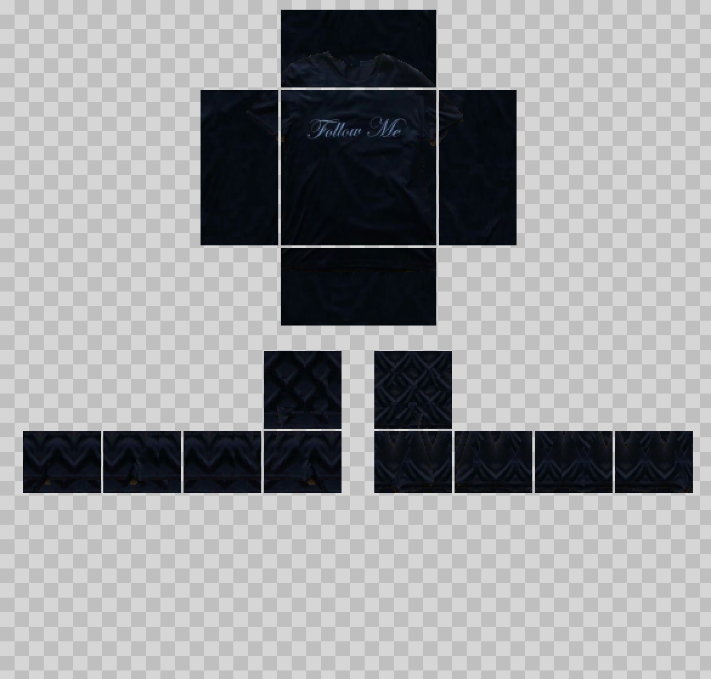
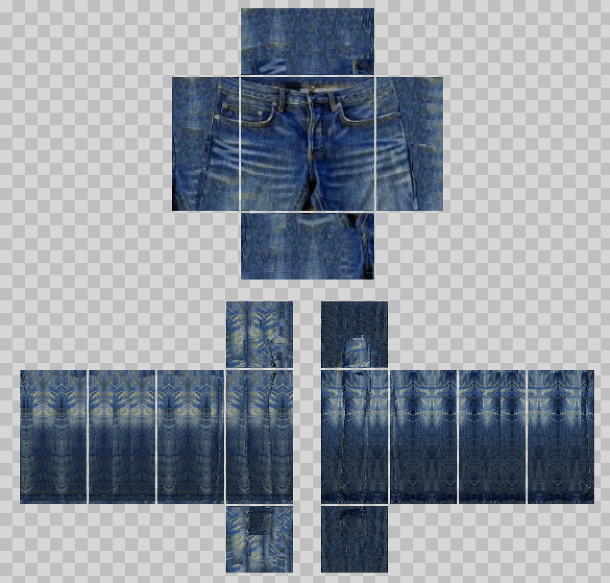
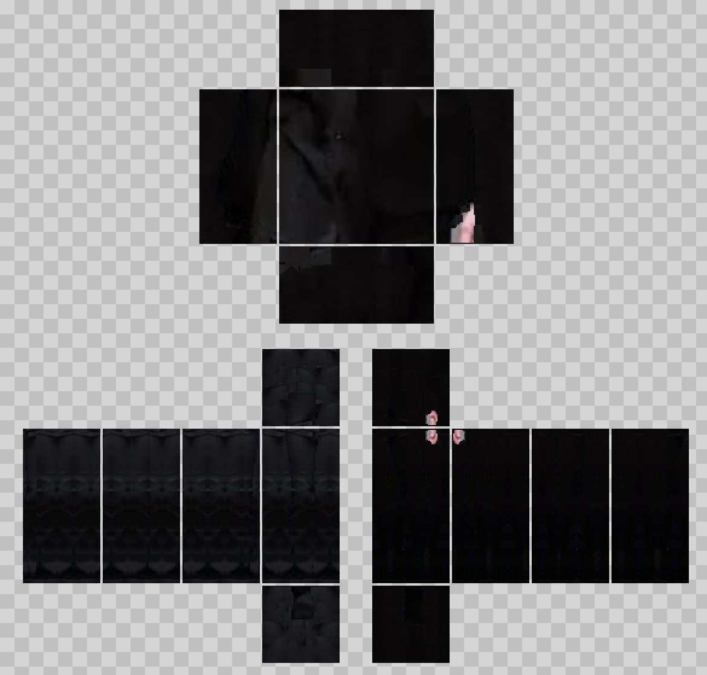

# Stage 3 photobash placement review

All four repository sample photos were rerun through Auto Bash with the default GrabCut setup. The black shirt and blue jeans are the two single-garment flat-lays. The remaining two photos show worn garments and multiple visible materials.

The two gray-shirt references show a front cutout crossing the torso seams, with separate photographed material on the arm faces. The renderer now carries the front image across the torso as a continuous layer and clones matching garment fabric into the remainder. The tests verify that the photographed texels in that layer survive unchanged and that every required classic face has full alpha coverage. The torso and a full-length limb have separate uniform fit scales. Each matching cut or clone keeps its scale. The nine scores below describe appearance, which includes visible repetitions and differences where the source does not show a surface.

All 18 regions agree with the supplied official shirt and pants illustrations after registration to their cropped and enlarged JPEGs. The exact 585 × 559 pixel coordinates are checked independently.

| Sample | Placement | Proportions | Edges | Seams | Fabric | Shading | Details | Color | Back and sides |
|---|---:|---:|---:|---:|---:|---:|---:|---:|---:|
| Black shirt, flat-lay | 4 | 4 | 4 | 3 | 3 | 3 | 4 | 4 | 2 |
| Blue jeans, flat-lay | 4 | 4 | 4 | 3 | 3 | 3 | 4 | 4 | 2 |
| Black pants, worn | 2 | 2 | 2 | 2 | 2 | 2 | 2 | 3 | 1 |
| White shirt, worn | 3 | 3 | 2 | 2 | 3 | 2 | 2 | 3 | 2 |

- The black shirt keeps its dark fabric, collar, hem, and readable lettering. The torso front continues into the side faces and all eight short-sleeve bands are filled. Reflected folds are visible in the cloned sleeve fabric.
- The blue jeans retain the waist, pockets, fly, knees, and cuffs. All eight long leg faces are filled. Denim fading repeats across the cloned parts of the legs, especially near the knees.
- The black pants photo contains a jacket and visible hands. Some jacket and skin pixels still make it into the placement.
- The worn white shirt retained its patterned sleeves more cleanly after isolating their blue fabric. Its torso has an uneven photographed cutout, and the print sits close to the join with the top face.

Images below link to the raw transparent 585 × 559 PNGs. The checkerboard copies show the same pixels at 2×.

None of the four samples has a back photo, so the torso backs remain transparent. The wider 30-photo quality gate remains open.
