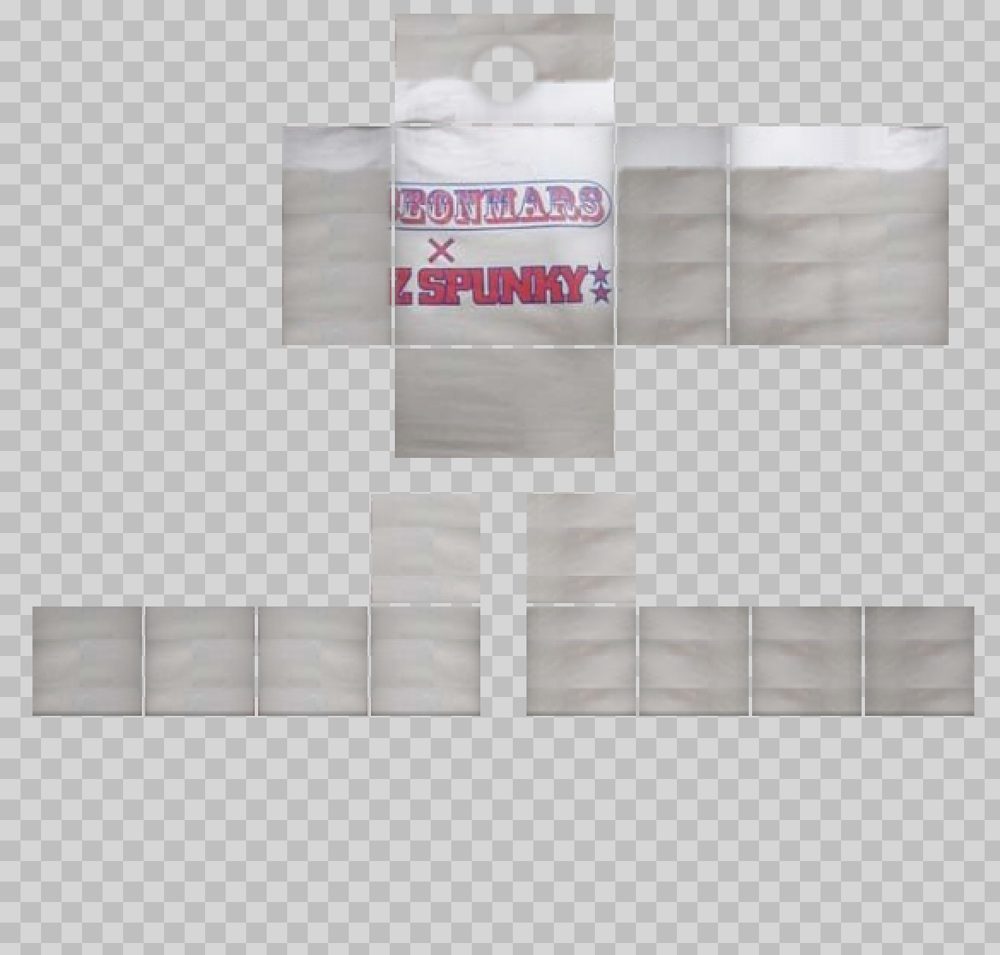

# Stage 4 visual review

All four photos in `samples/` were regenerated through the same Auto Bash pipeline used by the web app. The nine visual scores below are manual judgments from 1 to 5. **Estimated match** is the separate score displayed in Result, based on coverage, seam and color checks, and whether a face was inferred.

| Sample | Placement | Proportions | Edges | Seams | Fabric | Shading | Details | Color | Back and sides | Estimated match |
|---|---:|---:|---:|---:|---:|---:|---:|---:|---:|---:|
| Black shirt, flat-lay | 4 | 4 | 4 | 4 | 4 | 4 | 4 | 4 | 3 | 84% |
| Blue jeans, flat-lay | 4 | 4 | 4 | 3 | 3 | 4 | 4 | 4 | 3 | 77% |
| Black pants, worn | 3 | 3 | 3 | 3 | 2 | 3 | 2 | 3 | 2 | 63% |
| White shirt, worn | 2 | 2 | 3 | 3 | 2 | 3 | 2 | 3 | 2 | 60% |

- **Black shirt.** The open neck and the original chest lettering are still visible. The cloned back is clean, with minor folding repetitions in dark fabric.
- **Blue jeans.** The back now uses copied denim and a pair of tonal pocket stitches. The waistband is continuous at the sides, and some repeated creases are still visible on the leg wrap.
- **Black pants.** The cropped waist shows less jacket and the brighter hand pixels are largely gone. Some light specks, dark folds and repetitive fabric remain on the legs.
- **White shirt.** The neutral input matte removes most of the exposed skin and background. The supplied core chooses plain torso fabric for these sleeves, losing the blue star pattern. The front graphic is partially cropped.

The four real photos fall short of the 30-photo review set. Worn-shirt placement scores below 3, so the Stage 4 quality gate remains open. Pattern repeat and shading behavior also have synthetic regression tests.

Each enlarged checkerboard preview links to its raw 585 × 559 PNG.

