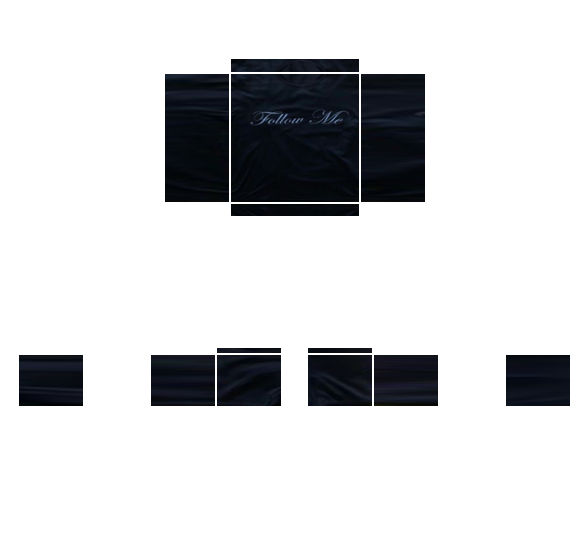
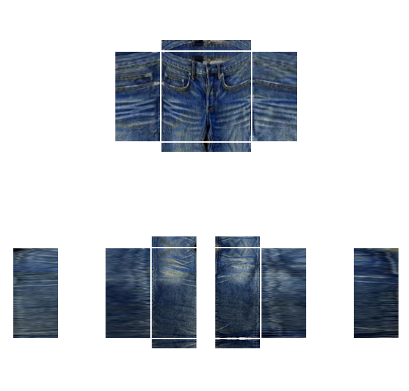

# Stage 3 placement review

Rendered all four repository photos through the Auto Bash pipeline with the default GrabCut setup. The black shirt and blue jeans are the two single-garment flat-lays on simple backgrounds. The other two photos were reviewed as lower-priority worn examples. Every template is a 585 × 559 transparent sRGB PNG.

## Visual scores

Scores are visual judgments on the nine criteria in AGENTS.md. **1** means missing or unusable, **3** means usable with visible issues, and **5** means excellent.

| Sample | Placement | Proportions | Edges | Seams | Fabric | Shading | Details | Color | Back and sides |
|---|---:|---:|---:|---:|---:|---:|---:|---:|---:|
| Black shirt, flat-lay | 4 | 4 | 4 | 2 | 3 | 3 | 4 | 4 | 1 |
| Blue jeans, flat-lay | 4 | 4 | 4 | 2 | 3 | 3 | 4 | 4 | 1 |
| Black pants, worn | 2 | 2 | 2 | 1 | 2 | 2 | 2 | 3 | 1 |
| White shirt, worn | 2 | 2 | 2 | 1 | 2 | 2 | 2 | 3 | 1 |

### Black shirt

The front lettering remains upright and legible at the template size. Both sleeves stop near the top of the arm faces. Inspection caught a warm fringe at the cuffs and a bright neck tag, so the sampling window was moved into the fabric. The side strips are visibly stretched under close inspection.

### Blue jeans

The waistband, fly, and pockets read clearly, and the two legs straighten into their own regions. The front and adjacent side faces share the same boundary pixels. The side strips still stretch the fading and creases, and the original lighting creates a visible difference between the two legs.

### Worn samples

The black outfit carries jacket material into the waist and retains a small hand fragment. The white top has uneven fabric edges, and part of the print and sleeves appear in the wrong places. These outputs need garment isolation and pose-aware landmarks for worn photos.

- [Black pants, worn](black-pants-on-body.png)
- [White shirt, worn](white-shirt-on-body-test.png)

All four inputs lack a back photo. Rear faces and unobserved cap depth remain transparent. The finished wrap and full-set quality gates are open. The repository currently has four real sample photos, and the automatic placement tests also exercise synthetic long sleeves, hoodies, shorts, and asymmetric front and back viewpoints.
