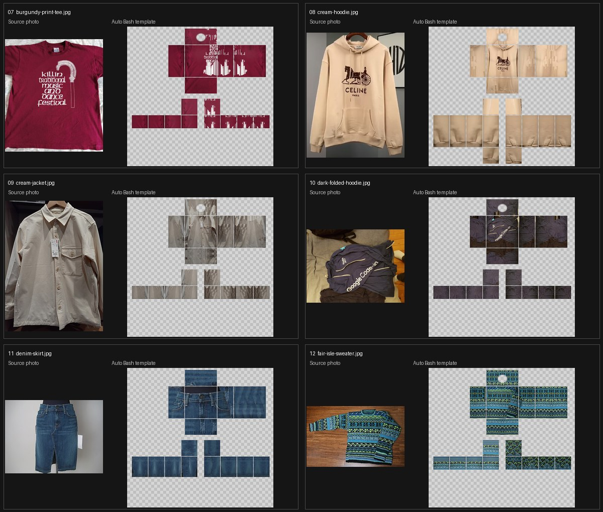
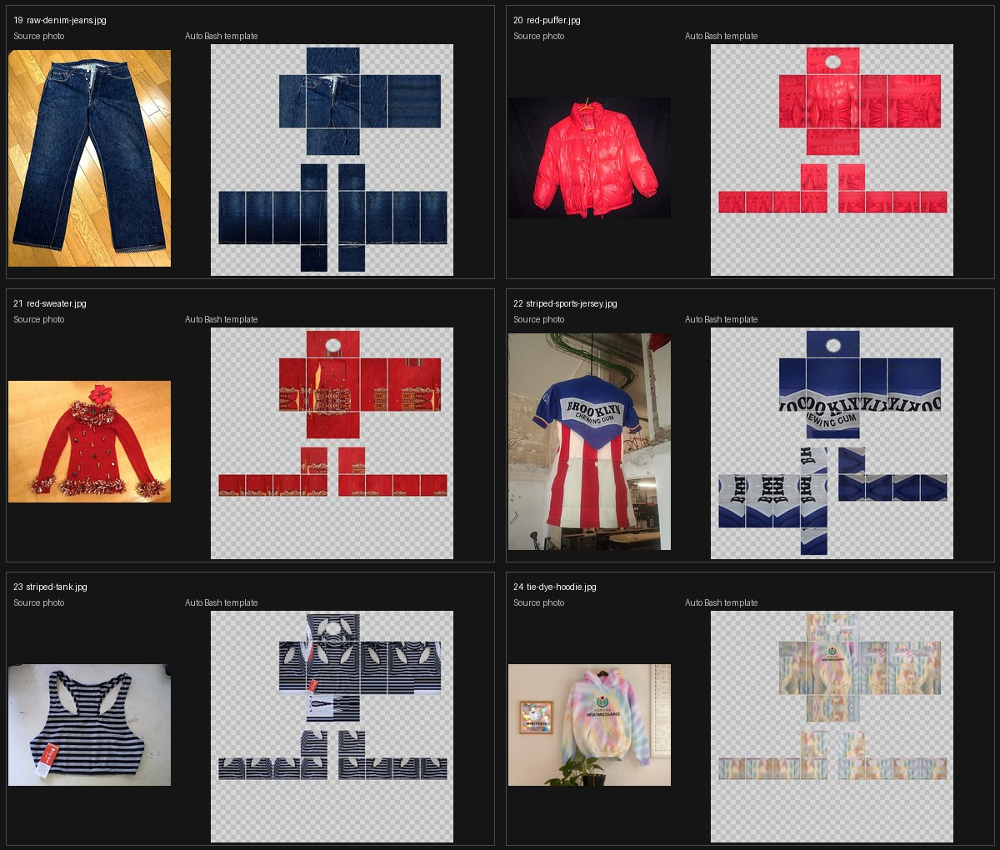
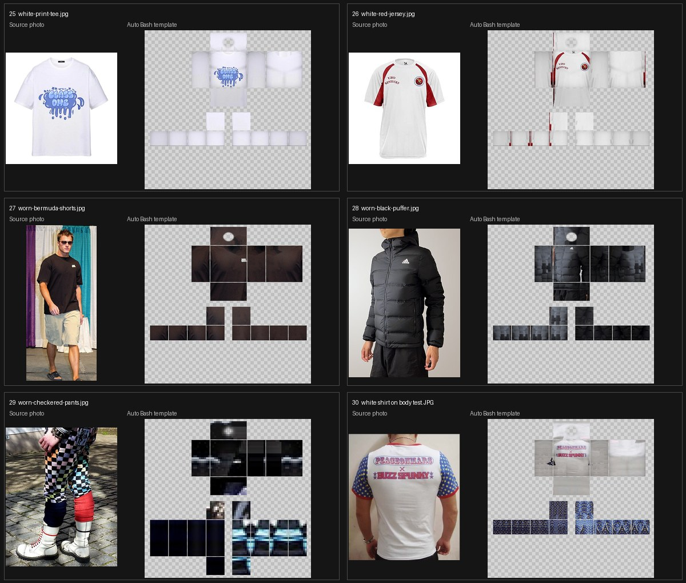

# Stage 8 golden sample review

Auto Bash attempted all 30 photos through the same pipeline as the web app and returned a template for each. **3 of 30** reached at least 4/5 on all nine criteria. **The quality gate remains open.**

The first pass returned 24 templates and skirt placement brought the total to 30. This pass restores repeating motifs on the inferred torso panels of the pink button-up and the Fair Isle sweater. The repair uses photographed fabric at the same scale, keeps the main front design in place, and repairs streaked short sleeves where the source shows enough sleeve fabric.

The scores below are visual judgments on a 1–5 scale. The in-app estimate is a separate automated confidence score. The review uses the four original inputs and 26 [attributed Wikimedia Commons photos](../golden/SOURCES.md), with single garments prioritized.

## Ratings

| Photo and template | Placement | Proportions | Edges | Seams | Fabric | Shading | Details | Color | Back and sides | Estimate | Notes |
|---|---:|---:|---:|---:|---:|---:|---:|---:|---:|---:|---|
| [black-pants-on-body](../black%20pants%20on%20body.JPG) · [PNG](black-pants-on-body.png) | 3 | 3 | 3 | 3 | 2 | 3 | 2 | 3 | 2 | 63% | The waist and legs are identifiable. Dark folds and copied cloth still hide some seams. |
| [black-shirt-test](../black%20shirt%20test.JPG) · [PNG](black-shirt-test.png) | 4 | 4 | 4 | 4 | 4 | 4 | 4 | 4 | 3 | 84% | The dark fabric, neckline and lettering read clearly. The guessed back repeats folds. |
| [blue-pants-test](../blue%20pants%20test.JPG) · [PNG](blue-pants-test.png) | 4 | 4 | 4 | 3 | 3 | 4 | 4 | 4 | 3 | 77% | The waist and cuffs read correctly. Some knee fades repeat around the wrap. |
| [beige-button-up](../golden/beige-button-up.jpg) · [PNG](beige-button-up.png) | 2 | 2 | 3 | 3 | 3 | 3 | 3 | 4 | 2 | 60% | The fuller cutout restores the collar and front. The arms are still short and a hanger shadow repeats on the back. |
| [black-long-sleeve](../golden/black-long-sleeve.jpg) · [PNG](black-long-sleeve.png) | 4 | 4 | 4 | 4 | 4 | 4 | 4 | 4 | 4 | 85% | Full sleeves and cuffs, clean dark color, and a plausible plain back. |
| [blue-lettered-tee](../golden/blue-lettered-tee.jpg) · [PNG](blue-lettered-tee.png) | 4 | 3 | 4 | 3 | 3 | 3 | 4 | 4 | 3 | 83% | The blue fabric and pale lettering are retained. The arm fills repeat the fabric shading. |
| [burgundy-print-tee](../golden/burgundy-print-tee.jpg) · [PNG](burgundy-print-tee.png) | 3 | 3 | 4 | 3 | 3 | 3 | 3 | 4 | 3 | 76% | The source crops the sleeves. Parts of the print repeat on the inferred fabric, and the torso graphic is fragmented. |
| [cream-hoodie](../golden/cream-hoodie.jpg) · [PNG](cream-hoodie.png) | 3 | 3 | 3 | 3 | 3 | 3 | 4 | 4 | 2 | 55% | The front branding and long sleeves read. The generated back lacks a convincing hood. |
| [cream-jacket](../golden/cream-jacket.jpg) · [PNG](cream-jacket.png) | 2 | 2 | 3 | 2 | 2 | 3 | 3 | 3 | 2 | 75% | The jacket stays a top. Arm length and copied tags need work. |
| [dark-folded-hoodie](../golden/dark-folded-hoodie.jpg) · [PNG](dark-folded-hoodie.png) | 2 | 2 | 2 | 2 | 2 | 3 | 2 | 3 | 2 | 81% | The folded front twists the lettering. The folds and concealed sleeves limit placement. |
| [denim-skirt](../golden/denim-skirt.jpg) · [PNG](denim-skirt.png) | 3 | 3 | 3 | 3 | 3 | 3 | 4 | 4 | 3 | 81% | The waistband, fly and denim hem read. The two leg fronts share the source panel, with the skirt slit approximated by the avatar geometry. |
| [fair-isle-sweater](../golden/fair-isle-sweater.jpg) · [PNG](fair-isle-sweater.png) | 2 | 2 | 3 | 3 | 3 | 3 | 3 | 4 | 3 | 67% | The knit bands now remain visible across the sides and back. The folded sleeve still limits placement. |
| [folded-denim](../golden/folded-denim.jpg) · [PNG](folded-denim.png) | 1 | 1 | 3 | 2 | 2 | 3 | 2 | 3 | 1 | 80% | The folded jeans are mistaken for a shirt. Neither full leg is visible. |
| [gray-snap-shirt](../golden/gray-snap-shirt.jpg) · [PNG](gray-snap-shirt.png) | 2 | 2 | 3 | 2 | 2 | 3 | 3 | 3 | 2 | 78% | Central buttons remain. The arms are shortened and the side joins pick up background. |
| [green-knit](../golden/green-knit.jpg) · [PNG](green-knit.png) | 2 | 3 | 3 | 3 | 3 | 3 | 3 | 4 | 2 | 78% | Both cuffs and sleeve patterns are visible. The photographed rear sits on the front and the inferred panel still repeats knit lines. |
| [navy-shirt-back](../golden/navy-shirt-back.jpg) · [PNG](navy-shirt-back.png) | 2 | 3 | 4 | 3 | 3 | 3 | 2 | 4 | 2 | 81% | The rear-only view becomes the front. The sleeves are shortened. |
| [pink-print-button-up](../golden/pink-print-button-up.jpg) · [PNG](pink-print-button-up.png) | 3 | 3 | 3 | 3 | 3 | 3 | 4 | 4 | 3 | 64% | Whole motifs replace side and back streaks. Both short sleeves use printed fabric and some mirrored joins remain visible. |
| [plaid-button-up](../golden/plaid-button-up.jpg) · [PNG](plaid-button-up.png) | 2 | 2 | 3 | 2 | 2 | 3 | 3 | 3 | 2 | 55% | The collar and front checks are recognizable. Side and sleeve checks do not align. |
| [raw-denim-jeans](../golden/raw-denim-jeans.jpg) · [PNG](raw-denim-jeans.png) | 4 | 4 | 4 | 4 | 4 | 4 | 4 | 4 | 4 | 80% | The waist and full-length dark legs are clear. The quieter denim wraps consistently. |
| [red-puffer](../golden/red-puffer.jpg) · [PNG](red-puffer.png) | 3 | 3 | 3 | 3 | 3 | 3 | 3 | 4 | 2 | 80% | The arms reach the cuffs and the zipper is visible. Copied quilting on the upper caps remains apparent. |
| [red-sweater](../golden/red-sweater.jpg) · [PNG](red-sweater.png) | 3 | 3 | 3 | 2 | 3 | 3 | 3 | 4 | 2 | 80% | The decorated cuffs now sit at the ends of full sleeves. Some floor color and repeated ornament remain. |
| [striped-sports-jersey](../golden/striped-sports-jersey.jpg) · [PNG](striped-sports-jersey.png) | 2 | 2 | 3 | 2 | 2 | 3 | 2 | 3 | 2 | 66% | Only part of the striped body is on the front. Letters repeat on the arms and back. |
| [striped-tank](../golden/striped-tank.jpg) · [PNG](striped-tank.png) | 3 | 3 | 3 | 3 | 3 | 3 | 3 | 3 | 3 | 70% | Arm faces are clear and the inferred back keeps the main stripe pattern. The retail tag and pale interiors of the strap openings remain visible. |
| [tie-dye-hoodie](../golden/tie-dye-hoodie.jpg) · [PNG](tie-dye-hoodie.png) | 3 | 3 | 3 | 2 | 3 | 3 | 3 | 4 | 2 | 79% | Both sleeves are full length and the dye is retained. The underside and hood shape remain inferred. |
| [white-print-tee](../golden/white-print-tee.jpg) · [PNG](white-print-tee.png) | 4 | 4 | 4 | 4 | 4 | 4 | 4 | 4 | 4 | 82% | Clean white fabric, a legible centered graphic, and plausible inferred panels. |
| [white-red-jersey](../golden/white-red-jersey.jpg) · [PNG](white-red-jersey.png) | 3 | 3 | 4 | 3 | 3 | 3 | 4 | 4 | 3 | 74% | The chest details survive. Red sleeve panels are mostly lost from the wrap. |
| [worn-bermuda-shorts](../golden/worn-bermuda-shorts.jpg) · [PNG](worn-bermuda-shorts.png) | 1 | 1 | 3 | 3 | 3 | 3 | 2 | 2 | 1 | 62% | Auto picks the visible shirt instead of the intended shorts in the full outfit. |
| [worn-black-puffer](../golden/worn-black-puffer.jpg) · [PNG](worn-black-puffer.png) | 2 | 2 | 3 | 2 | 2 | 3 | 3 | 3 | 2 | 79% | The torso quilting is visible. The long sleeves and back lose structure. |
| [worn-checkered-pants](../golden/worn-checkered-pants.jpg) · [PNG](worn-checkered-pants.png) | 1 | 1 | 1 | 2 | 2 | 2 | 1 | 2 | 1 | 76% | Auto picks shirt mode, keeping trouser fabric in torso and arm panels. |
| [white-shirt-on-body-test](../white%20shirt%20on%20body%20test.JPG) · [PNG](white-shirt-on-body-test.png) | 3 | 3 | 3 | 3 | 3 | 3 | 4 | 4 | 3 | 47% | Both patterned sleeves and the full photographed print are visible. Small sleeve fragments remain at the torso edge. |

15 outputs still score below 3 on placement, edges, or seams. Folded jeans and worn checkered pants still land in shirt mode. Photos showing the back, obscured clothes, hood placement, and joins in difficult patterns continue to need work.

## Visual review

Each sheet pairs the source photo with the rendered template. Use the PNG link in the table for the native-size export. See enlarged previews of the [pink button-up](review/pink-print-button-up.jpg), [Fair Isle sweater](review/fair-isle-sweater.jpg), and [denim skirt](review/denim-skirt.jpg).

